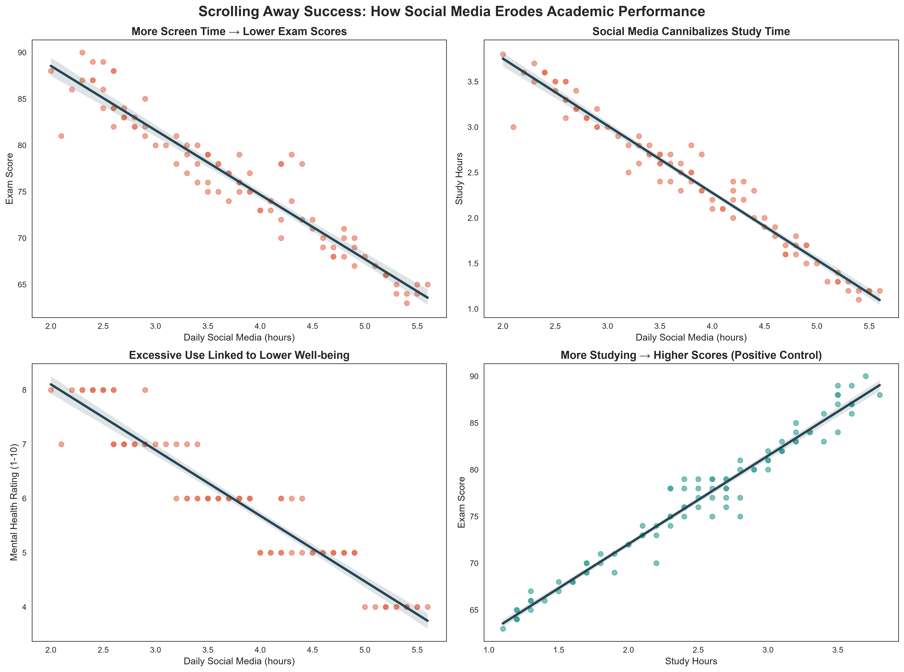
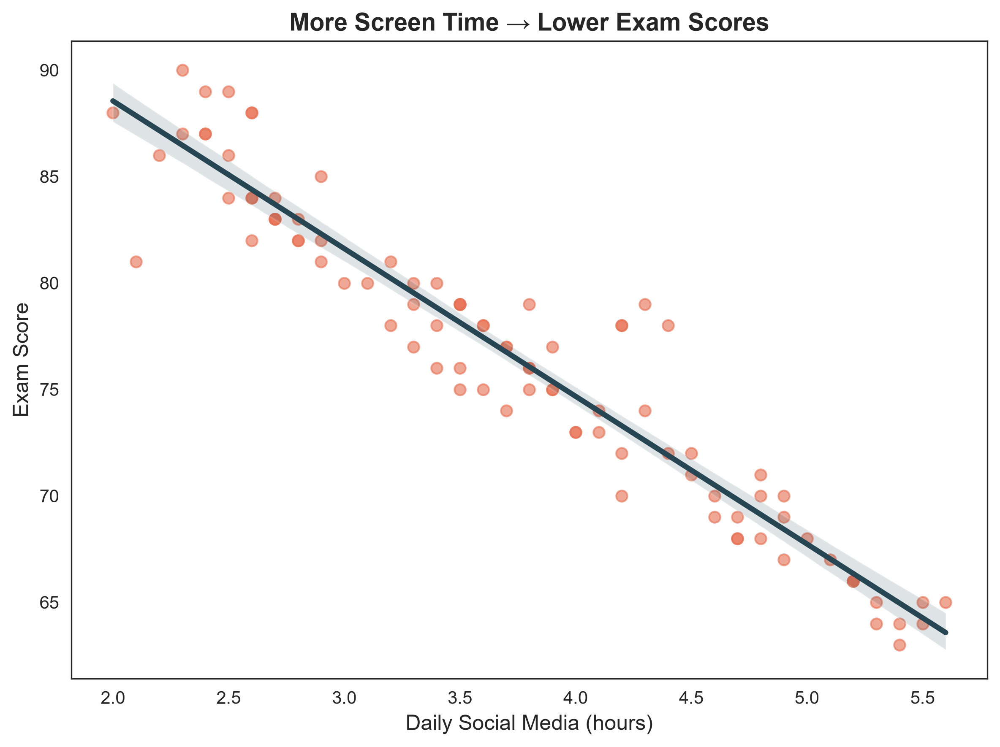
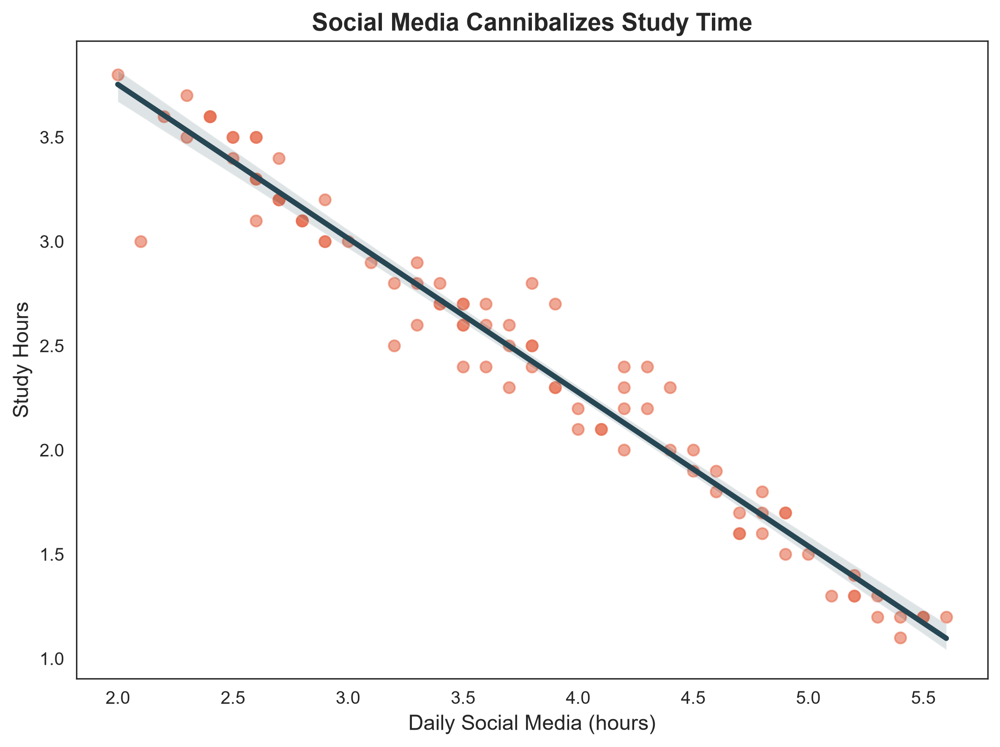

# practice
My data analysis projects on Social Media Usage vs Student Performance

## 1. Problem / Research Question
**Research Question:** Among young Pakistani students, is heavy social-media use genuinely harmful to academic performance, and if so, through which channel? 

**Main Takeaway:** Heavy social-media use is negatively associated with academic performance. The data suggests this harm operates primarily through "displacement" — heavy users are not inherently weaker students, but their scrolling displaces study time and coincides with lower mental well-being.

## 2. Dataset Source and Usage Permissions
- **Dataset Name:** Pakistan Social Media Usage vs Student Performance
- **Source Link:** [Kaggle Dataset](https://www.kaggle.com/datasets/muneebmuhammadali/pakistan-social-media-usage-vs-student-performance)
- **Usage Permissions:** Publicly available on Kaggle for educational and analytical purposes. (Note: The dataset is simulated and contains no real personal data).

## 3. Methods and Tools
- **Tools:** Python (Pandas, Matplotlib, Seaborn)
- **Methods:** 
  - Exploratory Data Analysis (EDA) with scatter plots and ordinary-least-squares (OLS) trend lines.
  - A 2x2 small-multiples design to show a chain of four bivariate relationships: screen time vs. scores, screen time vs. study hours, screen time vs. well-being, and study hours vs. scores (positive control).
  - Added shaded 95% confidence bands to communicate uncertainty honestly.

## 4. Key Findings and Limitation
**Key Findings:**
1. **Exam Scores:** Strong negative association (r ≈ −0.96) between daily social-media hours and exam scores (18-point gap between light and heavy users).
2. **Study Displacement:** Screen time is tightly negatively associated with study hours (r ≈ −0.98).
3. **Well-being:** Heavy usage coincides with lower self-rated mental well-being (r ≈ −0.95).
4. **Positive Control:** Study hours and exam scores rise together (r ≈ +0.98), proving the measurement scale responds to productive inputs.

**Limitations:**
- The chart shows bivariate associations only; it does not control for unobserved confounders (e.g., age, platform type, motivation).
- The scatter-plus-line rendering can hide the fine distribution of points (overplotting).
- The dataset is simulated, so the visualization demonstrates a design argument rather than establishing facts about real students.

## 5. Instructions for Running the Analysis
1. Download the dataset from the Kaggle link provided above.
2. Install the required dependencies: `pip install pandas matplotlib seaborn`
3. Open the `practice00.ipynb` notebook and run all cells to reproduce the visualizations and analysis.

## 6. Visualization

*Figure 1: Comprehensive dashboard showing the chain of relationships.*

*Figure 2: Detailed view of daily social media hours vs. exam scores.*

*Figure 3: Detailed view of daily social media hours vs. study hours.*
